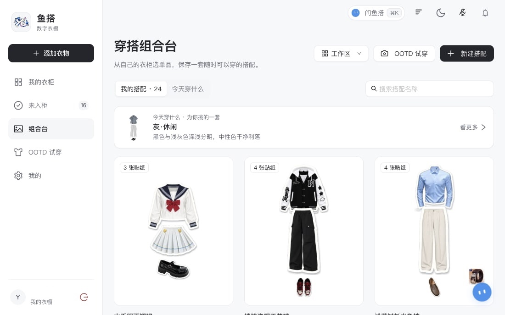
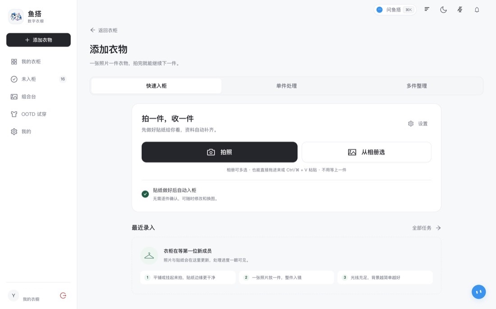
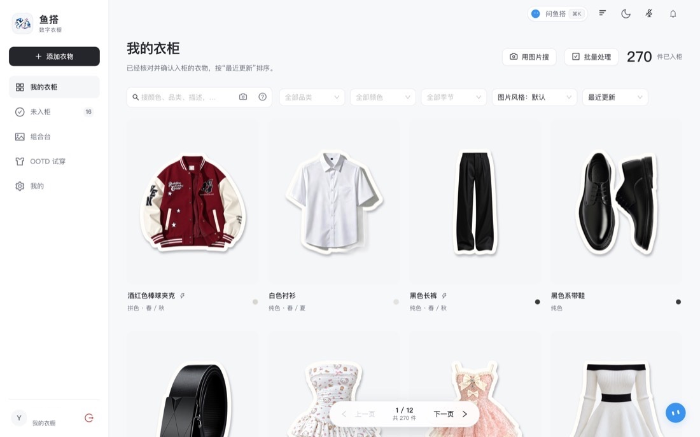
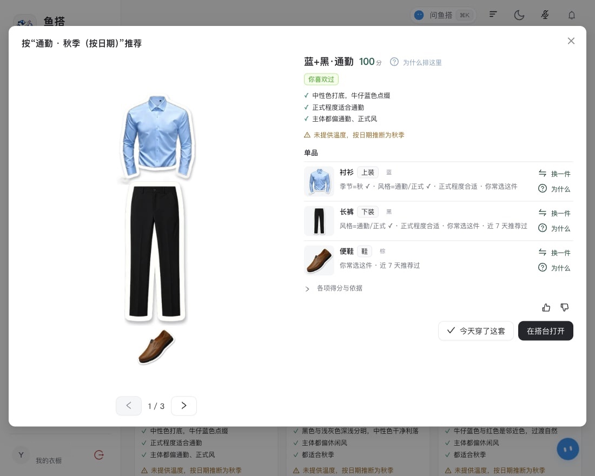
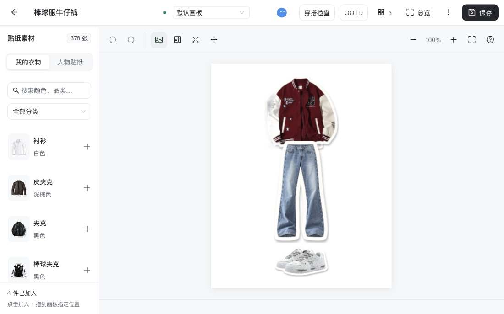
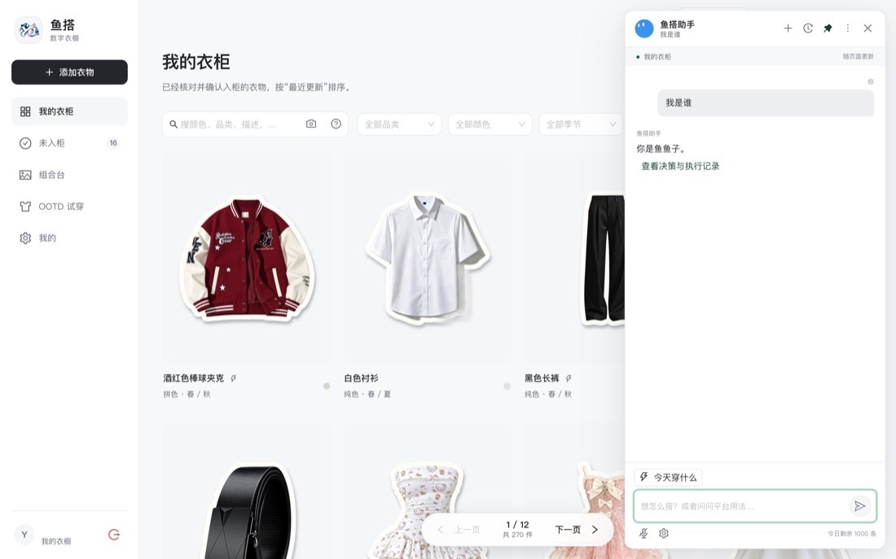
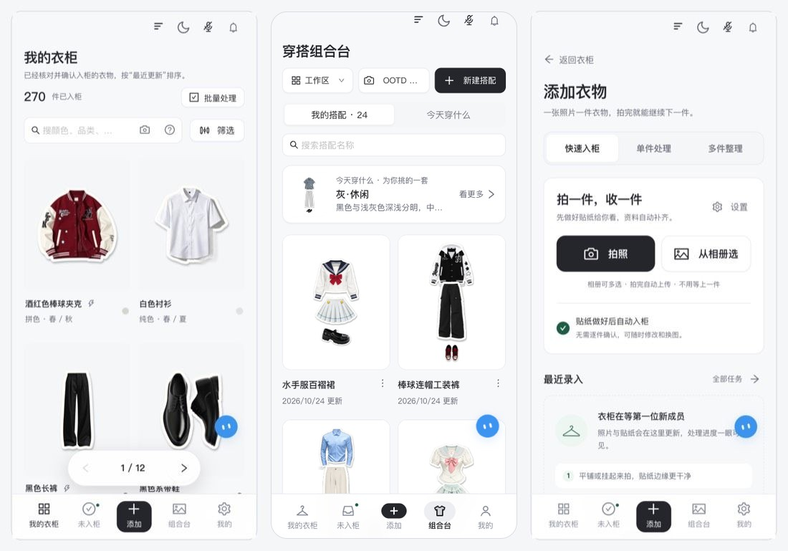
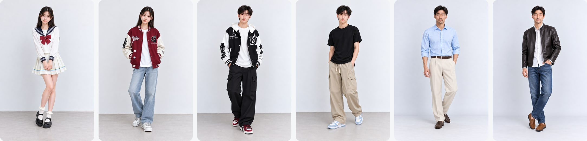
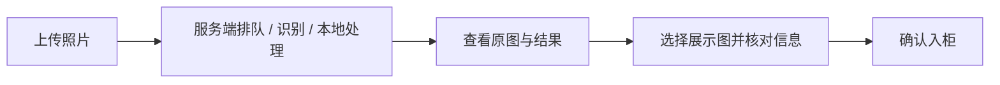

<div align="center">

# 鱼搭 · 数字衣柜（用户端）

**手机和桌面一起设计的数字衣柜界面：入柜、衣柜、推荐、搭台、助手、OOTD、实时试穿。**


[快速开始](#快速开始) · [功能](#功能) · [构建与发布](#构建与发布) · [相关仓库](#相关仓库) · [后端仓库（评审副本）](https://github.com/yumengjh/smart-closet-server-review) · [界面流程说明](docs/INTERACTION.md)



</div>

---

> ### ⚠️ 许可声明：源码仅供评审查看，不是开源软件
>
> 鱼搭是独立开发、计划商业化运营的 SaaS 产品。仓库开放，**只是为了让竞赛评委核验项目的真实性与 AI 协同开发过程**。
>
> | 允许（仅限评审人员） | 禁止（未经书面授权） |
> |:--|:--|
> | 阅读源码、文档与提交历史；在自己的设备上临时克隆、构建、运行和测试，用于核验与评分 | **复制、转发、Fork、镜像、公开发布；修改或二次开发；商业或生产使用；用于训练 AI 模型；提取规则、数据与设计做相似产品** |
>
> 完整条款见 [LICENSE](LICENSE)。需要其他用途，请先取得权利人书面授权。

这是鱼搭的**用户端**，需要配合后端使用。公开的后端是评审裁剪副本 [smart-closet-server-review](https://github.com/yumengjh/smart-closet-server-review)，完整后端 smart-closet-server 为私有仓库。后端提供接口、本地模型、推荐引擎和助手运行时；本仓库只负责界面与交互。两个仓库建议检出到相邻目录：

```text
project/
├── smart-closet          # 本仓库（用户端）
└── smart-closet-server   # 后端
```

独立运行前端的测试与构建不要求后端目录存在。

## 功能

| 模块 | 说明 |
|:--|:--|
| 账号 | 登录、凭邀请码注册、首次改密、登录设备管理、自助注销；会话失效自动回到登录 |
| 快速入柜 | 连拍上传，后台抠图与识别，处理中心统一查看任务、提醒与重试；顶部“我有这件 / 种草”切换，网上看中、还没买的衣服选种草再传截图 |
| 种草 | 还没买的衣服也存进衣柜：衣架与平铺有标记，衣柜可筛“全部 / 已拥有 / 种草”，不参与推荐与统计，可搜、可查重、可实时试穿，买到后一键标为已拥有；叫法可在「我的 → 界面偏好」自定义 |
| 我的衣柜 | “衣架”按品类分隔间叠挂、悬停展开，也可切回“平铺”网格；分页与键盘翻页、颜色精确筛选、语义搜索与以图搜图、相似衣物提示、回收站 |
| 今天穿什么 | 按天气与风格推荐，每套附依据；换一批、换一件、反馈 |
| 多画板搭台 | Konva 画板，多画板、图层、变换、导出；助手的方案落在临时画板 |
| 快速搭 | 上衣、下装上下两排左右滑动翻看，可锁住一排、随机一套；“评一评”用本地推荐引擎打分，不调用模型；满意后在搭台打开 |
| 全局助手 | 从底部导航胶囊的“问鱼搭”唤起（桌面 ⌘K / Ctrl K），默认在下方居中展开，可切换为覆盖右侧、右侧停靠或自由窗口；流式回复，操作以浏览器回执为准 |
| 个人 OOTD | 基准人物、多模特、动作、身材调节，生成前须确认 |
| 实时试穿（实验性，默认关闭） | 接入 XMax 实时视频生成，摄像头画面实时换上衣柜成品图或临时衣物；手机系统相机式全屏、PC 全宽舞台；本地姿态检查提示取景、无人 30 秒自动结束；拍照、有声分段录像、历史与下载；点开始后才计费 |
| 主题与导航 | 清新薄荷浅色 / 深色主题；所有宽度共用底部悬浮胶囊导航（没有侧栏），向下阅读时自动让开；手机底部面板、手势翻页；PWA |

## 界面一览

<table>
<tr>
<td width="50%"><br><sub><b>快速入柜</b></sub></td>
<td width="50%"><br><sub><b>我的衣柜</b></sub></td>
</tr>
<tr>
<td><br><sub><b>推荐有依据</b></sub></td>
<td><br><sub><b>多画板搭台</b></sub></td>
</tr>
<tr>
<td><br><sub><b>全局助手</b></sub></td>
<td><br><sub><b>手机端</b></sub></td>
</tr>
<tr>
<td colspan="2"><br><sub><b>OOTD 上身</b>：年轻女生、年轻男生、成熟男士；人物均为 AI 生成的虚拟模特</sub></td>
</tr>
</table>

## 快速开始

需要 Node.js 22+（本机验证使用 Node 24.18 / npm 11.16）。先启动后端（见[后端 README](https://github.com/yumengjh/smart-closet-server-review#源码运行开发)），再：

```sh
npm ci
npm run dev
```

Vite 默认把 `/api` 代理到 `127.0.0.1:8080`。登录后上传照片即可：



- 进度、模型调用和步骤耗时来自服务端；没有结果图时显示明确的等待状态。
- 只识别模式保留原图；AI 失败时保留照片，允许填写信息入柜；问题照片要求重新上传。
- 任务终态停止轮询，查询失败退避；刷新页面读取已提交任务，**不自动重试付费请求**。
- 首次登录先进入“设置新密码”；遇到 `401` 回到登录，`403 PASSWORD_CHANGE_REQUIRED` 回到密码设置。

<details>
<summary>界面演示模式（无需后端）</summary>

只有显式设置 `VITE_USE_MOCKS=true npm run dev` 才会使用浏览器示例数据。演示模式全程标注，禁止提交与重试 AI，不用定时器伪造完成状态或识别值。正常运行无需设置此变量。

</details>

## 构建与发布

| 命令 | 用途 |
|:--|:--|
| `npm run dev` | 开发服务器，代理 `/api` 到后端 |
| `npm run build:server` | 构建并发布到相邻后端的 `src/main/resources/static/`，由 Spring Boot 同源提供 |
| `npm run build:standalone` | 独立静态站点，API 地址由 `VITE_API_BASE_URL` 指定 |
| `npm run typecheck` | `vue-tsc` 类型检查 |
| `npm test` | 单元测试（Node 内置测试运行器） |
| `npm run deploy:local` | 本机一键构建并重启后端 |
| `npm run setup:pose` | 下载实时试穿取景检查用的 MediaPipe 姿态模型与运行库到 `public/tryon-pose/` 并做 SHA256 校验；三个构建命令会自动先执行，资源不进 Git |

**同源发布**（本机或局域网使用）：

```sh
npm run build:server
cd ../smart-closet-server && mvn spring-boot:run
```

后端 `static/assets/` 是被忽略的构建产物，干净检出必须先执行此构建再打包后端。`build:server` 固定以 `VITE_USE_MOCKS=false` 构建。局域网访问时给后端设置 `SERVER_ADDRESS=0.0.0.0`。

**独立部署**（前端静态站点 + 后端分开）：复制 `.env.example` 为 `.env.production.local`，填写公开的 `VITE_API_BASE_URL`，执行 `npm run build:standalone`，把 `dist/` 交给任意静态服务器；后端需配置 `CLOSET_CORS_ALLOWED_ORIGINS` 与 `CLOSET_COOKIE_SECURE`。详见[前后端独立部署](https://github.com/yumengjh/smart-closet-server-review/blob/main/docs/INDEPENDENT_DEPLOYMENT.md)。

推送 `v*` 标签时，持续集成会发布静态站点。

### 版本号

设置页导航底部显示「前端 v… · 提交号」和「服务端 v… · 提交号」，用来确认线上跑的是哪一版。

- 前端：构建时注入。打 `v*` 标签部署时用标签（`v1.2.0` 显示为 `v1.2.0`），否则用 `package.json` 的 `version`；提交号来自 CI 的 `GITHUB_SHA` 或本地 `git rev-parse`。也可用 `CLOSET_APP_VERSION`、`CLOSET_APP_COMMIT` 手动指定。
- 服务端：读公开的 `/api/health`（`version`、`commit`）；本地运行显示 `dev`。

## 目录

```text
src/
  views/          页面：登录、衣柜、录入、详情、任务、搭配、我的……
  wardrobe/       衣柜列表、筛选、翻页
  recommend/      今天穿什么、推荐卡片与依据
  outfit/         画板（Konva）、画板切换与保存
  agent/          全局助手面板与命令执行回执
  ootd/           基准人物、模特、动作、OOTD
  tryon/          实时试穿：相机、SDK 适配、录像、舞台布局、姿态检查
  presets/        预设衣物库
  similar/        相似衣物与以图搜图
  notifications/  处理中心与提醒
  services/       API 封装（api.ts、platform.ts）、音效
  stores/         Pinia 状态
  domain/         与服务端对应的领域逻辑（角色分类、图片规则等）
  shell/          主布局、底部胶囊导航、添加菜单、新手指引
  theme/ styles/  主题与全局样式
tests/            单元测试
docs/             界面流程、PWA、OOTD 界面设计、评审记录
```

## 测试与持续集成

```sh
npm run typecheck
npm test
npm run build
```

**GitHub Actions 是日常检查与 `v*` 标签自动部署的主平台**（2026-11-05 起）。`.github/workflows/frontend.yml` 响应 main 推送、PR、版本标签或手动触发：依赖审计（high/critical 阻断）、`npm ci`、测试、类型检查、真实 API 构建。普通分支/PR 不部署；只有 `v*` 标签在检查通过后调用可复用 `deploy.yml`：检查后端接口 → 构建 → SSH 覆盖站点 → 刷新 CDN → 核对线上。`Deploy frontend` 也保留手动入口。

全部与生产依赖 audit JSON、完整提交号保留在 `frontend-security-reports` artifact 30 天。部署变量使用仓库 Actions Secrets（`DEPLOY_SSH_HOST/USER/KEY` 或 PASSWORD、`DEPLOY_SSH_KNOWN_HOSTS`；可选 PORT、`DEPLOY_PATH`、`DEPLOY_SITE_URL`、`FRONTEND_API_BASE_URL`、`TENCENTCLOUD_SECRET_ID/KEY`、`CDN_PURGE_PATHS`）。工作流会前置检查密钥；本次修复分支 CI 不验证生产部署权限。

Semaphore 配置保留，但自动检查和自动 promotion 已停用。CircleCI（`.circleci/config.yml`）仍默认不运行；手动 `auto=true` 只检查，`release=true` 才在 `v*` 标签运行备用发版，`deploy=true` 部署所选分支。使用备用部署前须停止相应 Actions 部署，各平台并发控制不能跨平台互斥。

先提交、推送 CI 配置，再在包含该配置的提交上打版本标签。旧提交、旧标签仍使用其对应版本的配置；发版前确认三家平台没有旧部署任务仍在运行或排队。

后端回归在 `smart-closet-server` 执行 `mvn test`。

## 开发约定

- 所有可见交互控件统一使用 **Ant Design Vue**，不混用原生 select、checkbox、textarea、浏览器 prompt / confirm；完整约定见 [AGENTS.md](AGENTS.md)。
- 全局助手从导航胶囊的“问鱼搭”唤起，默认在下方居中展开，不改变主布局尺寸；只有用户选择右侧停靠时才挤开页面。
- 音效走 `src/services/sound.ts` 并尊重开关；动效尊重 `prefers-reduced-motion`。
- 改界面先改本仓库源码，再用 `npm run build:server` 发布，不手工改后端的构建产物。

## 相关仓库

| 仓库 | 内容 | 可见性 |
|---|---|---|
| [smart-closet](https://github.com/yumengjh/smart-closet) | 用户端（本仓库）：Vue 3 + Ant Design Vue | 公开（评审许可） |
| [smart-closet-server-review](https://github.com/yumengjh/smart-closet-server-review) | 后端评审裁剪副本，核心规则与提示词已移除，不能直接构建 | 公开（评审许可） |
| smart-closet-server | 完整后端 | 私有 |
| [smart-closet-mp](https://github.com/yumengjh/smart-closet-mp) | 微信小程序（uni-app） | 公开（评审许可） |
| [smart-closet-admin](https://github.com/yumengjh/smart-closet-admin) | 管理平台前端（Vue 3 + Element Plus） | 公开 |
| [smart-closet-admin-server](https://github.com/yumengjh/smart-closet-admin-server) | 管理平台后端（Spring Boot） | 公开 |
| [yuda-website](https://github.com/yumengjh/yuda-website) | 产品官网 | 公开 |
| [smart-closet-promo](https://github.com/yumengjh/smart-closet-promo) | 演示视频（Remotion） | 公开 |

## 更多文档

- [页面流程与状态说明](docs/INTERACTION.md) · [PWA](docs/PWA.md) · [OOTD 模特、动作与身材调节界面](docs/2026-10-12-OOTD模特、动作与身材调节界面.md)
- [衣物入库设计](https://github.com/yumengjh/smart-closet-server-review/blob/main/docs/design/衣物入库最新设计.md) · [平台级鱼搭与个人 OOTD 设计](https://github.com/yumengjh/smart-closet-server-review/blob/main/docs/design/2026-10-06-平台级鱼搭助手与个人OOTD设计.md) · [后端运行与接口文档](https://github.com/yumengjh/smart-closet-server-review/blob/main/docs/CLOSET_PRODUCT.md)

## 许可

本仓库采用[鱼搭源码可见评审许可](LICENSE)：**源码仅供竞赛评审人员核验之用，不是开源软件**。未经权利人书面授权，不得复制、转发、公开发布、Fork、修改、二次开发、商业使用，或将其用于训练 AI 模型。第三方组件与预训练模型遵循各自原有的许可证。
